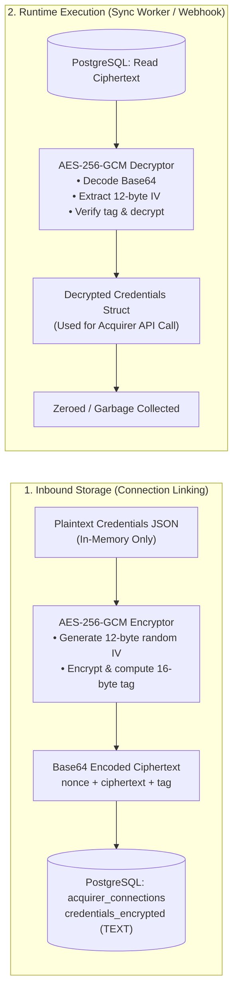

# Technical Architecture & Design: Midaz Receivables Plugin

## 1. System Overview & Hexagonal Architecture

The **Midaz Receivables Plugin (`midaz-plugin-receivables`)** is designed as an autonomous, high-throughput microservice adhering strictly to **Hexagonal Architecture (Ports and Adapters)**, **CQRS (Command Query Responsibility Segregation)**, and **Strict English Nomenclature**.

```mermaid
flowchart TB
    subgraph Acquirers["External Acquirers Ecosystem"]
        SumUp["SumUp REST APIs & Webhooks"]
        PagBank["PagBank REST APIs & Webhooks"]
    end

    subgraph ReceivablesPlugin["Midaz Plugin: Receivables (Go + Fiber)"]
        direction TB
        Main["cmd/app/main.go"] --> Bootstrap["internal/bootstrap"]
        
        subgraph PortsAdapters["Hexagonal Architecture"]
            HTTPIn["Adapters: HTTP In<br/>• /api/manifest<br/>• /health<br/>• /v1/accounts/receivables<br/>• /v1/accounts/receivables/:id/connections<br/>• /v1/connections/:id/sync<br/>• /v1/webhooks/sumup/:connection_id<br/>• /v1/webhooks/pagbank/:connection_id<br/>• /v1/webhooks/matcher"]
            
            subgraph AppServices["Application Services (CQRS)"]
                CmdCreateAcc["Command: CreateReceivablesAccount"]
                CmdCreateConn["Command: CreateAcquirerConnection"]
                CmdSyncConn["Command: SyncAcquirerConnection"]
                CmdIngestSale["Command: IngestAcquirerSale"]
                CmdSettleMatch["Command: SettleMatchedReceivable"]
                CmdBootstrap["Command: EnsureAcquirerAccounts"]
                QryAcc["Query: GetReceivablesAccount"]
                QryConn["Query: ListAcquirerConnections"]
                QryCalendar["Query: GetReceivablesCalendar"]
            end
            
            subgraph Domain["Domain Layer (Core Logic)"]
                IAcquirer["Port: AcquirerProvider"]
                IMidaz["Port: MidazLedgerClient"]
                IMatcher["Port: MatcherClient"]
                IRepo["Port: ReceivablesRepository"]
            end
            
            subgraph ExtAdapters["Adapters: Out"]
                AdapterSumUp["Provider: SumUp Adapter"]
                AdapterPagBank["Provider: PagBank Adapter"]
                AdapterMidaz["HTTP Out: Midaz Client"]
                AdapterMatcher["HTTP Out: Matcher 6 Client"]
                AdapterPostgres["Storage: PostgreSQL Repository"]
            end
        end

        HTTPIn --> AppServices
        AppServices --> Domain
        IAcquirer -.-> AdapterSumUp
        IAcquirer -.-> AdapterPagBank
        IMidaz -.-> AdapterMidaz
        IMatcher -.-> AdapterMatcher
        IRepo -.-> AdapterPostgres
    end

    subgraph MidazAndMatcher["Ledger & Reconciliation Platform"]
        MidazCore["Midaz Ledger Core (v3.4.8)<br/>Port 3000 / 3001"]
        Matcher6["Matcher 6 Engine (v6.0.0-beta.1)<br/>Port 4018"]
        PluginOF["Midaz Open Finance Plugin<br/>Port 8080"]
    end

    SumUp -->|Sales & Webhooks| HTTPIn
    PagBank -->|Sales & Webhooks| HTTPIn
    AdapterMidaz -->|POST /transactions| MidazCore
    AdapterMatcher -->|POST /v1/imports/...| Matcher6
    Matcher6 -->|Approved Matches Webhook| HTTPIn
    PluginOF -.->|Pushes Bank Credits (Source B)| Matcher6
```

---

## 2. Directory Structure

```
plugin-receivables/
├── cmd/
│   └── app/
│       └── main.go                             # Service entrypoint, graceful shutdown, DI
├── internal/
│   ├── bootstrap/
│   │   ├── config.go                           # Configuration struct with env tags
│   │   ├── service.go                          # Dependency injection container & HTTP runner
│   │   └── config_test.go                      # Configuration unit tests
│   ├── domain/
│   │   ├── account.go                          # Entity: ReceivablesAccount
│   │   ├── connection.go                       # Entity: AcquirerConnection (credentials, status)
│   │   ├── sale.go                             # Entity: Sale, Installment, Status
│   │   ├── settlement.go                       # Entity: MatcherSettlementResult
│   │   ├── acquirer.go                         # Port: AcquirerProvider interface
│   │   ├── midaz_client.go                     # Port: IMidazLedgerClient interface
│   │   ├── matcher_client.go                   # Port: IMatcherClient interface
│   │   └── repository.go                       # Port: IReceivablesRepository interface
│   ├── services/
│   │   ├── command/
│   │   │   ├── create_receivables_account.go   # Provisions account in Midaz & persists locally
│   │   │   ├── create_acquirer_connection.go   # Binds acquirer credentials to account
│   │   │   ├── sync_acquirer_connection.go     # Pulls sales/calendar for a given connection
│   │   │   ├── ingest_acquirer_sale.go         # Ingests sale, calculates MDR, posts to Midaz
│   │   │   ├── settle_matched_receivable.go    # Transfers from @receivables to @checking
│   │   │   └── ensure_acquirer_accounts.go     # Validates @external/acquirer_* accounts
│   │   └── query/
│   │       ├── get_receivables_account.go      # Retrieves account by ID or alias
│   │       ├── list_acquirer_connections.go    # Lists connections for an account
│   │       ├── get_receivables_calendar.go     # Queries installment schedule by date range
│   │       └── get_manifest.go                 # Midaz Console plugin manifest
│   ├── adapters/
│   │   ├── providers/
│   │   │   ├── factory.go                      # AcquirerProvider resolver
│   │   │   ├── sumup/
│   │   │   │   ├── client.go                   # SumUp REST API client
│   │   │   │   ├── parser.go                   # Normalization of SumUp sales & payouts
│   │   │   │   └── webhook_handler.go          # Webhook validation & payload extraction
│   │   │   └── pagbank/
│   │   │       ├── client.go                   # PagBank API client
│   │   │       ├── parser.go                   # Normalization of PagBank orders & charges
│   │   │       └── webhook_handler.go          # Webhook validation & payload extraction
│   │   ├── http/
│   │   │   ├── in/
│   │   │   │   ├── router.go                   # Fiber router setup & middleware attachment
│   │   │   │   ├── account_handler.go          # Account provisioning & query endpoints
│   │   │   │   ├── connection_handler.go       # Connection binding & sync trigger endpoints
│   │   │   │   ├── sumup_webhook_handler.go    # Webhook receiver for SumUp events
│   │   │   │   ├── pagbank_webhook_handler.go  # Webhook receiver for PagBank events
│   │   │   │   ├── matcher_webhook_handler.go  # Webhook receiver for Matcher 6 match events
│   │   │   │   ├── manifest_handler.go         # /api/manifest endpoint
│   │   │   │   └── health_handler.go           # Health & readiness probes
│   │   │   └── out/
│   │   │       ├── midaz_client.go             # Midaz Onboarding & Transaction client
│   │   │       └── matcher_client.go           # Matcher 6 Ingestion & Run client
│   │   └── postgres/
│   │       ├── repository.go                   # PostgreSQL state storage implementation
│   │       ├── migrator.go                     # Embedded golang-migrate runner
│   │       └── migrations/
│   │           ├── 000001_init_schema.up.sql
│   │           └── 000001_init_schema.down.sql
│   ├── crypto/
│   │   ├── encryptor.go                        # AES-256-GCM encryption & decryption engine
│   │   └── encryptor_test.go                   # Cryptographic unit tests
│   └── workers/
│       ├── connection_sync_worker.go           # Periodic background sync of active connections
│       └── matcher_upload_worker.go            # Periodic background upload of Source A records
├── docs/                                       # Technical documentation suite
├── examples/                                   # Example JSON payloads
├── Dockerfile                                  # Multi-stage production build
├── docker-compose.yml                          # Turnkey local environment
├── go.mod
└── go.sum
```

---

## 3. Database Schema & Migration Specification (PostgreSQL)

The internal PostgreSQL database governs accounts, connections, sales, installments, and reconciliation tracking:

```sql
-- Migration: 000001_init_schema.up.sql

CREATE TYPE connection_status AS ENUM (
    'ACTIVE',
    'INACTIVE',
    'EXPIRED',
    'ERROR'
);

CREATE TYPE installment_status AS ENUM (
    'PENDING_SETTLEMENT', -- Ingested in Midaz, awaiting bank payout
    'RECONCILED',         -- Matched via Matcher 6 & settled in Midaz
    'CANCELLED',          -- Cancelled or refunded prior to payout
    'CHARGEBACK',         -- Contested by cardholder
    'OVERDUE'             -- Expected payout date passed without match
);

-- Receivables Account (1 per merchant/tenant)
CREATE TABLE IF NOT EXISTS receivables_accounts (
    id UUID PRIMARY KEY DEFAULT gen_random_uuid(),
    organization_id UUID NOT NULL,
    ledger_id UUID NOT NULL,
    midaz_account_id UUID NOT NULL,
    account_alias VARCHAR(255) NOT NULL UNIQUE,
    checking_account_alias VARCHAR(255) NOT NULL,
    name VARCHAR(255) NOT NULL,
    status VARCHAR(50) NOT NULL DEFAULT 'ACTIVE',
    created_at TIMESTAMP WITH TIME ZONE NOT NULL DEFAULT NOW(),
    updated_at TIMESTAMP WITH TIME ZONE NOT NULL DEFAULT NOW()
);

-- Acquirer Connections (N per Receivables Account)
CREATE TABLE IF NOT EXISTS acquirer_connections (
    id UUID PRIMARY KEY DEFAULT gen_random_uuid(),
    receivables_account_id UUID NOT NULL REFERENCES receivables_accounts(id) ON DELETE CASCADE,
    acquirer_type VARCHAR(50) NOT NULL,       -- 'SUMUP', 'PAGBANK'
    display_name VARCHAR(100) NOT NULL,
    credentials_encrypted TEXT NOT NULL,     -- AES-256-GCM encrypted base64 ciphertext
    status connection_status NOT NULL DEFAULT 'ACTIVE',
    auto_sync_enabled BOOLEAN NOT NULL DEFAULT true,
    sync_interval_minutes INT NOT NULL DEFAULT 60,
    last_sync_at TIMESTAMP WITH TIME ZONE,
    last_sync_status VARCHAR(50),
    last_sync_error TEXT,
    created_at TIMESTAMP WITH TIME ZONE NOT NULL DEFAULT NOW(),
    updated_at TIMESTAMP WITH TIME ZONE NOT NULL DEFAULT NOW(),
    CONSTRAINT uq_account_acquirer UNIQUE (receivables_account_id, acquirer_type, display_name)
);

-- Ingested Acquirer Sales
CREATE TABLE IF NOT EXISTS acquirer_sales (
    id UUID PRIMARY KEY DEFAULT gen_random_uuid(),
    connection_id UUID NOT NULL REFERENCES acquirer_connections(id) ON DELETE CASCADE,
    receivables_account_id UUID NOT NULL REFERENCES receivables_accounts(id) ON DELETE CASCADE,
    acquirer VARCHAR(50) NOT NULL,           -- 'SUMUP', 'PAGBANK'
    nsu VARCHAR(100) NOT NULL,
    tid VARCHAR(100),
    authorization_code VARCHAR(100),
    sale_date TIMESTAMP WITH TIME ZONE NOT NULL,
    gross_amount NUMERIC(18, 4) NOT NULL,
    total_mdr_fee NUMERIC(18, 4) NOT NULL,
    total_net_amount NUMERIC(18, 4) NOT NULL,
    installments_count INT NOT NULL DEFAULT 1,
    payment_method VARCHAR(50) NOT NULL,    -- 'CREDIT_CARD', 'DEBIT_CARD', 'PIX'
    card_brand VARCHAR(50),                 -- 'VISA', 'MASTERCARD', 'ELO'
    created_at TIMESTAMP WITH TIME ZONE NOT NULL DEFAULT NOW(),
    CONSTRAINT uq_connection_sale UNIQUE (connection_id, nsu)
);

-- Installments / Receivables Schedule
CREATE TABLE IF NOT EXISTS receivables_installments (
    id UUID PRIMARY KEY DEFAULT gen_random_uuid(),
    sale_id UUID NOT NULL REFERENCES acquirer_sales(id) ON DELETE CASCADE,
    connection_id UUID NOT NULL REFERENCES acquirer_connections(id) ON DELETE CASCADE,
    receivables_account_id UUID NOT NULL REFERENCES receivables_accounts(id) ON DELETE CASCADE,
    acquirer VARCHAR(50) NOT NULL,
    nsu VARCHAR(100) NOT NULL,
    installment_number INT NOT NULL,
    gross_amount NUMERIC(18, 4) NOT NULL,
    mdr_fee NUMERIC(18, 4) NOT NULL,
    net_amount NUMERIC(18, 4) NOT NULL,
    expected_settlement_date DATE NOT NULL,
    actual_settlement_date DATE,
    status installment_status NOT NULL DEFAULT 'PENDING_SETTLEMENT',
    midaz_receivable_tx_id UUID,            -- Transaction ID of the D+0 agenda booking
    midaz_settlement_tx_id UUID,            -- Transaction ID of the D+X settlement transfer
    matcher_record_id VARCHAR(255),         -- Ingestion ID pushed to Matcher 6
    matcher_run_id UUID,                    -- ID of Matcher 6 execution confirming match
    created_at TIMESTAMP WITH TIME ZONE NOT NULL DEFAULT NOW(),
    updated_at TIMESTAMP WITH TIME ZONE NOT NULL DEFAULT NOW(),
    CONSTRAINT uq_connection_installment UNIQUE (connection_id, nsu, installment_number)
);

CREATE INDEX idx_installments_expected_date ON receivables_installments(expected_settlement_date, status);
CREATE INDEX idx_installments_account ON receivables_installments(receivables_account_id, status);
CREATE INDEX idx_connections_sync ON acquirer_connections(auto_sync_enabled, status);
```

---

## 4. Cryptographic Security & At-Rest Credential Encryption

To ensure PCI-DSS, LGPD, and enterprise security compliance, merchant acquirer credentials (API keys, merchant codes, OAuth tokens, client secrets) are **never stored in plaintext on disk, in database tables, or in operational logs**.

### 4.1. Cryptographic Primitives
* **Algorithm:** `AES-256-GCM` (Galois/Counter Mode) via Go standard library `crypto/aes` and `crypto/cipher`.
* **Authenticated Encryption with Associated Data (AEAD):** Guarantees both **confidentiality** and **authenticity/integrity** (tamper detection). Any unauthorized modification of the ciphertext or IV causes decryption to fail immediately.
* **Key Derivation & Provisioning:** A 256-bit (32-byte) master key is loaded at startup from the `CREDENTIALS_ENCRYPTION_KEY` environment variable (hex-encoded or 32-character string). If missing or invalid, the service aborts startup immediately (fail-fast).
* **Initialization Vector (Nonce):** A fresh 12-byte cryptographically secure random nonce is generated for **every single encryption operation** via `crypto/rand`. Nonces are never reused.
* **Storage Encoding:** The output payload is formatted as:
  $$\text{Payload} = \texttt{Base64}(\text{Nonce [12 bytes]} \parallel \text{Ciphertext [N bytes]} \parallel \text{GCM Tag [16 bytes]})$$



### 4.2. Go Implementation Contract (`internal/crypto/encryptor.go`)
```go
package crypto

import (
	"crypto/aes"
	"crypto/cipher"
	"crypto/rand"
	"encoding/base64"
	"errors"
	"io"
)

type Encryptor interface {
	Encrypt(plaintext []byte) (string, error)
	Decrypt(ciphertextBase64 string) ([]byte, error)
}

type GCMEncryptor struct {
	key []byte
}

func NewGCMEncryptor(keyHex string) (*GCMEncryptor, error) {
	// Validates 32-byte key length and initializes encryptor
}
```

---

## 5. Idempotency & Fault Tolerance

1. **Deterministic Unique Keys:**
   - Every Midaz transaction has a deterministic code:
     - Agenda creation: `REC-<ACQUIRER>-<NSU>-<INSTALLMENT>`
     - Settlement: `SETTLE-<ACQUIRER>-<NSU>-<INSTALLMENT>`
   - Midaz rejects duplicate transaction codes natively with HTTP 409 / unique violation, guaranteeing that retried webhooks or overlapping worker batches can never duplicate ledger balance.
2. **Matcher 6 Ingestion Batching:**
   - Installments with `status = 'PENDING_SETTLEMENT'` within the settlement window ($T-3$ to $T+3$ days) are compiled into a JSON array and sent to Matcher 6 via `POST /v1/imports/contexts/{ctxId}/sources/{srcId}/upload`.
   - The Matcher record `id` matches `REC-<ACQUIRER>-<NSU>-<INSTALLMENT>`, enabling deterministic reconciliation callbacks.
3. **Graceful Degradation:**
   - If Matcher 6 is temporarily unreachable, the plugin retains the pending records and retries via exponential backoff.
   - If Midaz is temporarily unreachable during settlement, the Matcher webhook response returns HTTP 503 so Matcher re-delivers the event.
