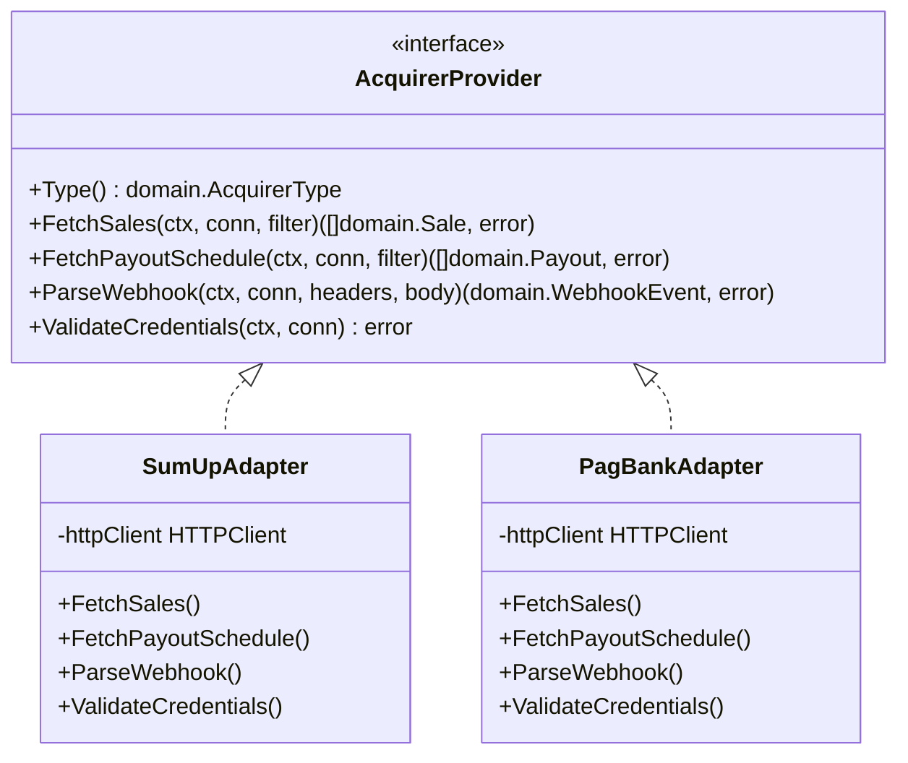

# Acquirer Providers Specification: SumUp & PagBank

## 1. Provider Strategy Overview

The **Midaz Receivables Plugin** interacts with card acquirers using a unified Port interface: `domain.AcquirerProvider`.

Because each merchant account can possess different credentials, the provider interface receives the specific `domain.AcquirerConnection` instance with decrypted credentials on every invocation.



---

## 2. SumUp Provider Specification

### 2.1. Credentials Schema
Stored in `acquirer_connections.credentials_encrypted`:
```json
{
  "api_key": "sup_live_abcd1234efgh5678",
  "merchant_code": "MC123456",
  "client_id": "optional_oauth_client_id",
  "client_secret": "optional_oauth_client_secret"
}
```

### 2.2. Webhook Routing
* **Endpoint:** `POST /v1/webhooks/sumup/:connection_id`
* The `:connection_id` path parameter enables the plugin to retrieve the specific connection and verify the webhook signature using that connection's secret.

### 2.3. Core Endpoints
1. **Transaction History:**
   - `GET /v0.1/me/transactions/history`
   - **Header:** `Authorization: Bearer <api_key>`
   - **Query Parameters:** `order=desc`, `limit=50`, `statuses=SUCCESSFUL`, `start_date=...`, `end_date=...`
2. **Payouts & Settlement Calendar:**
   - `GET /v0.1/me/payouts`
   - Returns date ranges, scheduled payout dates, and transaction IDs bundled into each bank wire.

### 2.4. Normalization to Domain Contracts
- `Sale.Acquirer`: `"SUMUP"`
- `Sale.NSU`: `transaction_code` (e.g. `"TD4K9X8L"`)
- `Sale.TID`: `id`
- `Sale.GrossAmount`: `amount` (e.g. 150.00)
- `Sale.TotalMDRFee`: `fee_amount` (e.g. 4.50)
- `Sale.TotalNetAmount`: `net_amount` (e.g. 145.50)
- `Sale.InstallmentsCount`: `installments_count` (e.g. 3)

---

## 3. PagBank (PagSeguro) Provider Specification

### 3.1. Credentials Schema
Stored in `acquirer_connections.credentials_encrypted`:
```json
{
  "token": "pbg_token_1234567890abcdef",
  "client_id": "pbg_client_987654321",
  "client_secret": "pbg_secret_xyz"
}
```

### 3.2. Webhook Routing
* **Endpoint:** `POST /v1/webhooks/pagbank/:connection_id`
* Authenticated using PagBank notification tokens.

### 3.3. Core Endpoints
1. **Orders & Charges Query:**
   - `GET /orders` or `GET /charges/{id}`
   - **Header:** `Authorization: Bearer <token>`
2. **Settlement EDI & Conciliation Statements:**
   - Ingests charge status transitions (`PAID`, `REFUNDED`, `CHARGED_BACK`).

### 3.4. Normalization to Domain Contracts
- `Sale.Acquirer`: `"PAGBANK"`
- `Sale.NSU`: `charges[0].payment_response.reference` or `charges[0].id`
- `Sale.GrossAmount`: `amount.value / 100` (e.g. 200.00)
- `Sale.InstallmentsCount`: `charges[0].payment_method.installments` (e.g. 2)
- `Sale.PaymentMethod`: `"CREDIT_CARD"`

---

## 4. Unified Go Domain Contracts

```go
package domain

import (
	"context"
	"time"

	"github.com/shopspring/decimal"
)

type AcquirerType string

const (
	AcquirerSumUp   AcquirerType = "SUMUP"
	AcquirerPagBank AcquirerType = "PAGBANK"
)

type AcquirerProvider interface {
	Type() AcquirerType
	ValidateCredentials(ctx context.Context, conn *AcquirerConnection) error
	FetchSales(ctx context.Context, conn *AcquirerConnection, filter SalesFilter) ([]Sale, error)
	FetchPayoutSchedule(ctx context.Context, conn *AcquirerConnection, filter PayoutFilter) ([]PayoutSchedule, error)
	ParseWebhook(ctx context.Context, conn *AcquirerConnection, headers map[string]string, body []byte) (WebhookEvent, error)
}

type SalesFilter struct {
	StartDate time.Time
	EndDate   time.Time
	Limit     int
	Cursor    string
}

type PayoutFilter struct {
	StartDate time.Time
	EndDate   time.Time
}

type PayoutSchedule struct {
	Acquirer               AcquirerType    `json:"acquirer"`
	PayoutID               string          `json:"payout_id"`
	ExpectedSettlementDate time.Time       `json:"expected_settlement_date"`
	GrossAmount            decimal.Decimal `json:"gross_amount"`
	FeeAmount              decimal.Decimal `json:"fee_amount"`
	NetAmount              decimal.Decimal `json:"net_amount"`
	AssociatedNSUs         []string        `json:"associated_nsus"`
}

type WebhookEvent struct {
	Type      string      `json:"type"` // "SALE_CREATED", "PAYOUT_COMPLETED", "CHARGEBACK"
	RawEvent  string      `json:"raw_event"`
	Sale      *Sale       `json:"sale,omitempty"`
	Payout    *PayoutSchedule `json:"payout,omitempty"`
}
```
