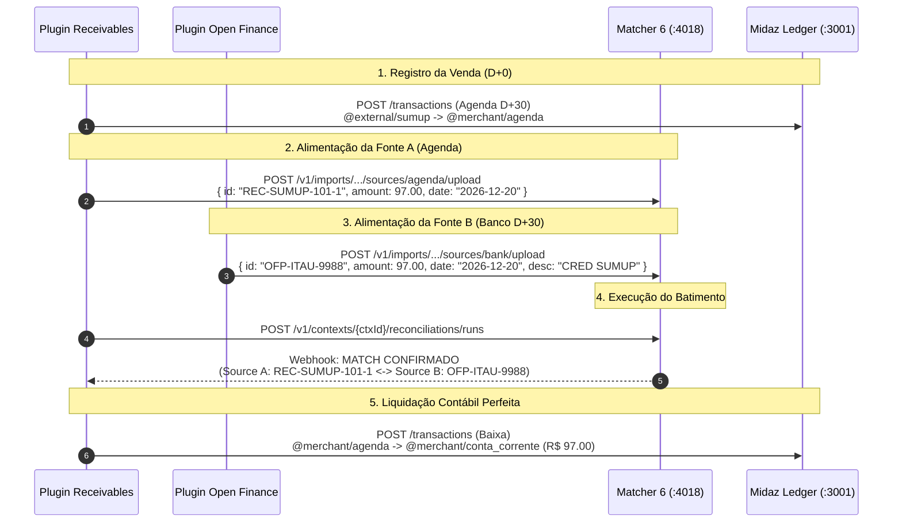

# Matcher 6 Reconciliation Specification

## 1. Matcher 6 Architecture Overview

The reconciliation between **Expected Receivables (Agenda)** and **Real-World Bank Statement Deposits (Open Finance)** is orchestrated by **Matcher 6** running locally on port `4018` (`http://localhost:4018`).



---

## 2. Matcher 6 Setup & Configuration

### 2.1. Context Provisioning
The plugin bootstraps a dedicated Context in Matcher 6:
* **Context Name:** `settlement_reconciliation`
* **Slug:** `acquirers-settlement`
* **Endpoint:** `POST /v1/contexts`

```json
{
  "name": "Acquirers Settlement Reconciliation",
  "slug": "acquirers-settlement",
  "description": "Cross-reconciliation between Acquirer Receivables Schedules and Open Finance Bank Statements"
}
```

### 2.2. Sources Configuration
Within the Context, two Sources are registered:
1. **Source A (Receivables Schedule):**
   - **Name:** `acquirer_receivables`
   - **Schema:**
     - `id` (string, unique key: `REC-<ACQUIRER>-<NSU>-<INSTALLMENT>`)
     - `expected_date` (date)
     - `net_amount` (numeric)
     - `merchant_id` (string)
     - `acquirer` (string)
2. **Source B (Bank Statement Credits):**
   - **Name:** `bank_statement_credits`
   - **Schema:**
     - `id` (string, unique key: `OFP-<BANK_TX_ID>`)
     - `booking_date` (date)
     - `credit_amount` (numeric)
     - `merchant_id` (string)
     - `description` (string)

---

## 3. Reconciliation Rule Matrix

Matcher 6 applies a multi-level matching rule set:

```
[RULE 1: Exact Match (High Confidence)]
  Condition:
    SourceA.net_amount == SourceB.credit_amount
    AND abs(SourceA.expected_date - SourceB.booking_date) <= 1 day
    AND SourceA.merchant_id == SourceB.merchant_id
  Action: APPROVE & AUTO-SETTLE

[RULE 2: Acquirer Batch Settlement (Many-to-One)]
  Condition:
    sum(SourceA.net_amount WHERE acquirer == X AND expected_date == D) == SourceB.credit_amount
    AND SourceA.merchant_id == SourceB.merchant_id
  Action: APPROVE BATCH & MULTI-DEBIT SETTLE (N:1)

[RULE 3: Unmatched Residuals (Discrepancy)]
  Condition:
    SourceA exists with expected_date < (NOW - 3 days) without match in SourceB
  Action: FLAG AS OVERDUE / GLOSA
```

---

## 4. Ingestion & Execution API Calls

### 4.1. Uploading Expected Schedule (Source A)
* **Endpoint:** `POST /v1/imports/contexts/{context_id}/sources/{source_a_id}/upload`
* **Format:** `multipart/form-data` with `format=json`
* **Payload:**
```json
[
  {
    "id": "REC-SUMUP-987654321-1",
    "expected_date": "2026-12-20",
    "net_amount": "97.00",
    "merchant_id": "merchant_123",
    "acquirer": "SUMUP"
  },
  {
    "id": "REC-PAGBANK-11223344-1",
    "expected_date": "2026-12-20",
    "net_amount": "194.00",
    "merchant_id": "merchant_123",
    "acquirer": "PAGBANK"
  }
]
```

### 4.2. Uploading Bank Statement Credits (Source B)
* Uploaded by `plugin-openfinance` or routed through the settlement queue:
```json
[
  {
    "id": "OFP-ITAU-TX9988",
    "booking_date": "2026-12-20",
    "credit_amount": "97.00",
    "merchant_id": "merchant_123",
    "description": "CREDITO TED SUMUP BRASIL"
  }
]
```

### 4.3. Triggering Reconciliation Run
* **Endpoint:** `POST /v1/contexts/{context_id}/reconciliations/runs`
* Returns `run_id` and initial status `PENDING` -> `RUNNING` -> `COMPLETED`.

---

## 5. Webhook Callback & Midaz Execution

When Matcher 6 finishes the reconciliation pass, it invokes the plugin's webhook receiver:
* **Endpoint:** `POST /v1/webhooks/matcher`
* **Callback Payload:**
```json
{
  "event": "RECONCILIATION_RUN_COMPLETED",
  "context_id": "3fa85f64-5717-4562-b3fc-2c963f66afa6",
  "run_id": "a9b8c7d6-e5f4-3210-9876-543210abcdef",
  "matches_count": 1,
  "matches": [
    {
      "match_id": "m-001",
      "rule_id": "rule_exact_settlement",
      "source_a_record_id": "REC-SUMUP-987654321-1",
      "source_b_record_id": "OFP-ITAU-TX9988",
      "amount": "97.00",
      "settlement_date": "2026-12-20"
    }
  ]
}
```

### Processing Logic upon Webhook Receipt:
1. Verify payload signature.
2. Query internal database for installment matching `source_a_record_id`.
3. Check if status is `PENDING_SETTLEMENT`. If already `RECONCILED`, exit idempotently (HTTP 200).
4. Invoke Midaz API:
   - Debit: `@<merchant_id>/agenda_recebiveis` (R$ 97.00)
   - Credit: `@<merchant_id>/conta_corrente` (R$ 97.00)
5. Update installment state to `RECONCILED` with `midaz_settlement_tx_id` and `matcher_run_id`.
6. Return HTTP 200 to Matcher 6.
