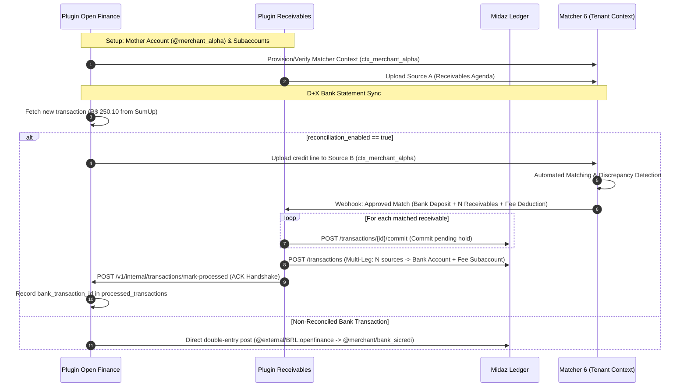

# Inter-Plugin Protocol: Open Finance & Receivables Choreography

## 1. Problem: The Double-Credit & Misattribution Hazard

In an integrated financial ledger system:
1. **Plugin Open Finance** mirrors real bank accounts (e.g., Sicredi, Itaú). Every time a deposit enters the bank statement, its default behavior is:
   $$\text{Midaz: } \texttt{@external/BRL:openfinance} \longrightarrow \texttt{@merchant/bank\_sicredi}$$
2. **Plugin Receivables** ingests card sales across multiple acquirers (SumUp, PagBank). On sale creation ($D+0$), it records:
   $$\text{Midaz: } \texttt{@acquirer/sumup} \overset{\text{pending: true}}{\longrightarrow} \texttt{@merchant/receivables}$$

If both plugins operate in silos without coordination:
* When the acquirer pays the merchant, the money hits the merchant's bank account.
* Open Finance perceives an incoming credit and blindly credits `@merchant/bank_sicredi` from `@external/BRL:openfinance`.
* **The Result:** The money is credited in `@merchant/bank_sicredi`, but the future claims in `@merchant/receivables` remain pending forever, causing balance inflation and loss of financial traceability.

---

## 2. Solution: The Multi-Tenant Mother Account & Inter-Plugin Handshake

To prevent this collision and eliminate cross-tenant leakage, the two plugins communicate via two primary synchronization points:



---

## 3. Account Hierarchy Model in Midaz

Every merchant profile is represented by a **Mother Account** in Midaz with native `parentAccountId` subaccounts:

```json
{
  "mother_account": {
    "id": "01948df2-mother-0001",
    "alias": "@merchant_alpha",
    "name": "Alpha Comércio Ltda",
    "cnpj": "12.345.678/0001-99"
  },
  "subaccounts": [
    {
      "alias": "@merchant_alpha/receivables",
      "parentAccountId": "01948df2-mother-0001",
      "type": "creditCard",
      "description": "Accrued future receivables agenda"
    },
    {
      "alias": "@merchant_alpha/receivables/fees",
      "parentAccountId": "01948df2-mother-0001",
      "type": "deposit",
      "description": "Tariffs, deductions, and acquirer machine rentals"
    },
    {
      "alias": "@merchant_alpha/bank_sicredi",
      "parentAccountId": "01948df2-mother-0001",
      "type": "checking",
      "description": "Mirrored Sicredi bank account"
    }
  ]
}
```

---

## 4. The Inter-Plugin ACK Handshake Endpoint

To guarantee that Open Finance never reprocesses or duplicates a bank transaction that was already settled by Receivables:

* **Endpoint:** `POST /v1/internal/transactions/mark-processed`
* **Port:** `http://plugin-openfinance:8085`
* **Payload:**
```json
{
  "bankTransactionId": "OFP-SICREDI-998877",
  "midazTransactionCode": "MIDAZ-MULTI-777",
  "status": "SETTLED_VIA_RECEIVABLES"
}
```
* **Behavior:** Open Finance registers the record into its `processed_transactions` table with status `SETTLED_VIA_RECEIVABLES`. Subsequent polling or webhooks bypass this transaction.
