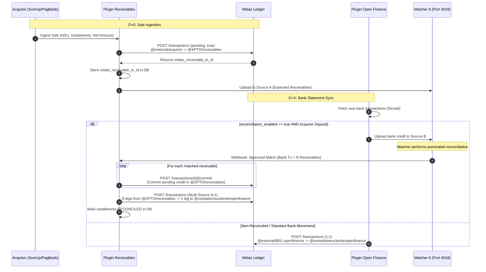

# Inter-Plugin Protocol: Open Finance & Receivables Choreography

## 1. Problem: The Double-Credit & Misattribution Hazard

In an integrated financial ledger system:
1. **Plugin Open Finance** mirrors real bank accounts (e.g., Sicredi, Itaú, Bradesco). Every time a deposit enters the bank statement, its default behavior is:
   $$\text{Midaz: } \texttt{@external/BRL:openfinance} \longrightarrow \texttt{@contadomeucliente/openfinance}$$
2. **Plugin Receivables** ingests card sales across multiple acquirers (SumUp, PagBank, Cielo). On sale creation ($D+0$), it records:
   $$\text{Midaz: } \texttt{@external/acquirer\_sumup} \overset{\text{pending: true}}{\longrightarrow} \texttt{@XPTO/receivables}$$

If both plugins operate in silos without orchestration:
* When the acquirer pays the merchant, the money hits the merchant's bank account.
* Open Finance perceives an incoming credit and blindly credits `@contadomeucliente/openfinance` from `@external/BRL:openfinance`.
* **The Result:** The money is credited in `@contadomeucliente/openfinance`, but the future claims in `@XPTO/receivables` remain pending forever, causing balance inflation and loss of financial traceability.

---

## 2. The Solution: Pre-Ingestion Matching & Multi-Source Two-Phase Settlement

To solve this, the plugins orchestrate via **Matcher 6** and Midaz's native **Two-Phase Commit** and **$N:1$ Multi-Source Transactions**:



---

## 3. Account Configuration Schema in `plugin-openfinance`

To enable this orchestration, accounts in `plugin-openfinance` specify their reconciliation target:

```json
{
  "id": "01948df2-abcd-7000-8000-000000000001",
  "bank_compe": "748",
  "bank_account_id": "sicredi_acc_998877",
  "midaz_account_alias": "@contadomeucliente/openfinance",
  "reconciliation_enabled": true,
  "reconciliation_receivables_account": "@XPTO/receivables"
}
```

### Configuration Fields:
- `reconciliation_enabled` (boolean): When `true`, incoming credits matching acquirer deposit criteria are diverted to Matcher 6 before posting to Midaz.
- `reconciliation_receivables_account` (string): The alias of the receivables account (e.g. `@XPTO/receivables`) holding the pending/accrued installments.

---

## 4. Multi-Source $N:1$ Midaz Settlement Contract

When Matcher 6 reconciles 1 bank deposit against $N$ scheduled receivables (e.g. 1 bank deposit of R$ 300.00 matched against 3 receivables: R$ 200.00 from SumUp, R$ 50.00 from PagBank, R$ 50.00 from PagBank):

1. **Phase 1: Commit Pending Receivables**
   The plugin issues `POST /v1/organizations/{org}/ledgers/{ledger}/transactions/{id}/commit` for each of the 3 receivables. This commits the transactions in `@XPTO/receivables`, releasing them from pending hold.

2. **Phase 2: Multi-Source Transfer ($N$ Sources $\rightarrow$ 1 Destination)**
   The plugin posts a single multi-source transaction to Midaz:

```json
{
  "chartOfAccountsGroupName": "OPEN_FINANCE_SYNC",
  "description": "Open Finance Deposit OFP-SICREDI-998877 (Conciliated with 3 Receivables)",
  "code": "OFP-SICREDI-998877",
  "send": {
    "asset": "BRL",
    "value": "300.00",
    "source": {
      "from": [
        {
          "accountAlias": "@XPTO/receivables",
          "amount": { "asset": "BRL", "value": "200.00" },
          "description": "Receivable REC-SUMUP-1001-1 (NSU: 1001)"
        },
        {
          "accountAlias": "@XPTO/receivables",
          "amount": { "asset": "BRL", "value": "50.00" },
          "description": "Receivable REC-PAGBANK-2001-1 (NSU: 2001)"
        },
        {
          "accountAlias": "@XPTO/receivables",
          "amount": { "asset": "BRL", "value": "50.00" },
          "description": "Receivable REC-PAGBANK-2002-1 (NSU: 2002)"
        }
      ]
    },
    "distribute": {
      "to": [
        {
          "accountAlias": "@contadomeucliente/openfinance",
          "amount": { "asset": "BRL", "value": "300.00" },
          "description": "Credit Mirrored Open Finance Bank Account"
        }
      ]
    }
  }
}
```

---

## 5. Non-Reconciled Fallback Transactions

All other movements in the bank account (e.g. outgoing wire transfers, debit charges, payroll, generic Pix deposits):
- Do **not** touch `@XPTO/receivables`.
- Continue using the standard Open Finance direct posting:
  - For debits: `@contadomeucliente/openfinance` $\rightarrow$ `@external/BRL:openfinance`
  - For credits: `@external/BRL:openfinance` $\rightarrow$ `@contadomeucliente/openfinance`
