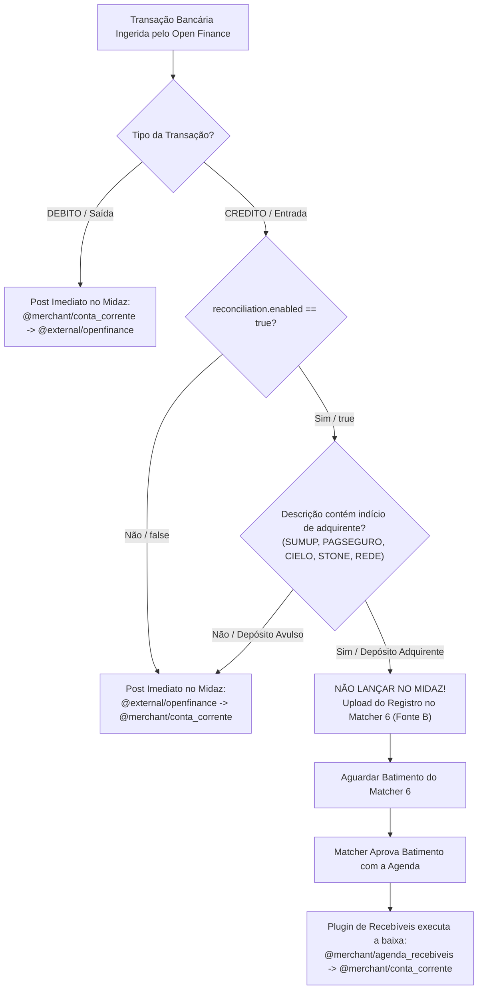

# Inter-Plugin Protocol: Open Finance & Receivables Choreography

## 1. Problem: The Double-Credit Hazard

In an enterprise banking architecture:
1. **Plugin Open Finance** monitors real bank accounts. Every time a deposit enters the bank, its default behavior is:
   $$\text{Midaz: } \texttt{@external/BRL:openfinance} \longrightarrow \texttt{@merchant/conta\_corrente}$$
2. **Plugin Receivables** monitors card acquirers. Every time a card sale is made, it records:
   $$\text{Midaz: } \texttt{@external/acquirer\_sumup} \longrightarrow \texttt{@merchant/agenda\_recebiveis}$$

If both plugins operate independently without coordination:
* When the acquirer pays the merchant, the money hits the merchant's bank account.
* Open Finance perceives a bank deposit and credits `@merchant/conta_corrente`.
* **The Result:** The merchant now has money in `@merchant/agenda_recebiveis` AND money in `@merchant/conta_corrente`. The balance is **duplicated**, and the receivables agenda is never closed!

---

## 2. The Solution: The `reconcile` Account Flag

To prevent this collision, an inter-plugin contract is established via the account configuration within `plugin-openfinance`.

### Account Configuration Schema in `plugin-openfinance`:
```json
{
  "account_id": "01948df2-abcd-7000-8000-000000000001",
  "account_alias": "@merchant_123/conta_corrente",
  "bank_connection_id": "conn_itau_998877",
  "reconciliation": {
    "enabled": true,
    "target_agenda_account": "@merchant_123/agenda_recebiveis",
    "matcher_context_id": "3fa85f64-5717-4562-b3fc-2c963f66afa6",
    "matcher_source_id": "bank_statement_credits",
    "matcher_url": "http://matcher-app:4018"
  }
}
```

---

## 3. Decision Tree inside `plugin-openfinance`

When `plugin-openfinance` ingests a bank transaction:



---

## 4. Shared Ingestion Contract: Source B Payload

When `plugin-openfinance` flags a bank deposit for reconciliation, it formats the item and sends it to Matcher 6:

```json
{
  "id": "OFP-ITAU-TX998877",
  "booking_date": "2026-12-20",
  "credit_amount": "97.00",
  "merchant_id": "merchant_123",
  "account_alias": "@merchant_123/conta_corrente",
  "agenda_alias": "@merchant_123/agenda_recebiveis",
  "description": "CREDITO TED SUMUP BRASIL",
  "bank_name": "BANCO ITAU UNIBANCO S.A.",
  "raw_transaction_id": "TX998877"
}
```

---

## 5. Fallback & Orphan Credits Handling

What happens if a bank credit is marked for reconciliation, but after 5 days no matching receivable is found in the agenda?

1. **Matcher Discrepancy Alert:** Matcher 6 registers the item as `UNMATCHED` in Source B.
2. **Fallback Resolution Policy:**
   - **Option 1 (Auto-Release):** After a configurable SLA (e.g. 7 days), the credit is released as a generic deposit into `@merchant_123/conta_corrente` from `@external/BRL:openfinance` with metadata `"reconciliation_status": "UNMATCHED_FALLBACK"`.
   - **Option 2 (Manual Review):** The transaction remains pending in a reconciliation queue visible in the Midaz Console dashboard for manual operator pairing.
